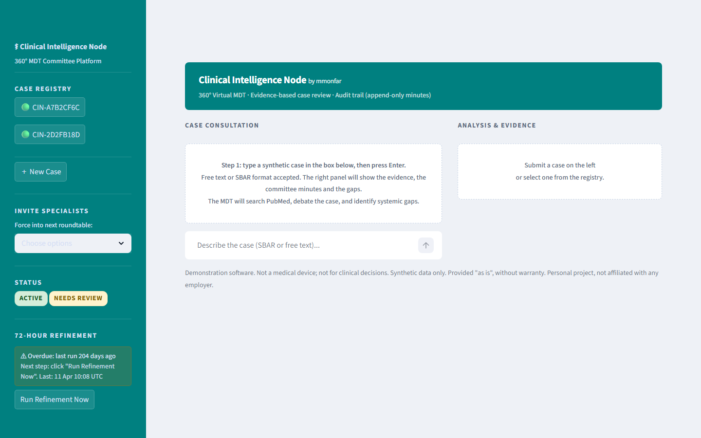
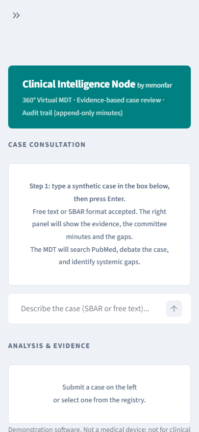

# Clinical Intelligence Node

A multi-agent virtual M&M (Morbidity & Mortality) Committee platform.
Analyses clinical cases against tiered medical evidence. Produces structured MDT minutes, saved by appending (earlier minutes are not overwritten).



On a phone: 

*Screenshot with synthetic data.*

---

## ⚠️ Disclaimer

**All clinical cases used in development, testing, and demonstration of this platform are entirely fictional.**
They were created solely to test software functionality and do not represent any real patient, clinical encounter, or medical record.
No real patient data has been used or stored at any point.

This tool is **not a substitute for clinical judgement**. It is a decision-support aid intended to augment, not replace, qualified medical professionals.
Always involve appropriate clinical specialists before acting on any output.

---

## Architecture

This repo has two separate parts. The **Streamlit app** in the table below uses cloud models through the OpenAI API, so it needs an API key. The **debate engine** (`debate/`, see [below](#debate-engine-research-software)) uses local models only, through Ollama. The app does not call the debate engine yet.

Three LLM agents collaborate on each case:

| Agent | Model | Temp | Role |
|---|---|---|---|
| Researcher | gpt-4o-mini | 0.0 | PubMed multi-pillar evidence search + synthesis |
| MDT Roundtable | gpt-4o | 0.25 | 360° specialist debate, gap-finding, risk heatmap |
| Auditor | gpt-4o-mini | 0.0 | Formal Markdown M&M minutes |

### Evidence Ladder

1. RCT / Meta-analysis / Systematic Review
2. Practice Guidelines (NCCN / AHA / ESC / ESMO / NICE / WHO)
3. Clinical Trial / Observational Study
4. Case Reports *(rare/emerging conditions only)*

When an initial query returns fewer than 2 results the Researcher automatically triggers **Multi-Pillar decomposition**:

- **Pillar A — The Conflict:** intersection of the two main complications
- **Pillar B — The Guidelines:** primary life-threat guideline search
- **Pillar C — The Procedure:** interventional / procedural evidence

---

## Features

- Free-text or SBAR case input via chat interface
- Dynamic MDT panel selection from 25+ specialties
- Mandatory invitee list (force any specialist into the roundtable)
- Risk Heatmap (High / Medium / Low per clinical risk)
- Critical Information Gap banner
- Evidence Matrix tab with clickable PubMed links
- Formal M&M minutes, appended per session (no model-version log yet; see docs/GOVERNANCE.md)
- 72-hour automated refinement cycle with contradiction detection
- EPR copy-paste buffer + Markdown download

---

## Setup

### 1. Clone

```bash
git clone https://github.com/your-username/clinical-node.git
cd clinical-node
```

### 2. Create virtual environment

```bash
python -m venv venv
# Windows
venv\Scripts\activate
# macOS / Linux
source venv/bin/activate
```

### 3. Install dependencies

```bash
pip install -r requirements.txt
```

### 4. Configure credentials

```bash
cp .env.example .env
```

Edit `.env` and add your keys:

| Variable | Source |
|---|---|
| `OPENAI_API_KEY` | [platform.openai.com](https://platform.openai.com/api-keys) |
| `ENTREZ_EMAIL` | Your email — required by NCBI |
| `ENTREZ_API_KEY` | [NCBI account](https://www.ncbi.nlm.nih.gov/account/) — optional, raises rate limit to 10 req/s |

### 5. Run

```bash
streamlit run app.py
```

---

## Debate engine (research software)

The `debate/` package is a support tool for use before an M&M meeting. Local models (MedGemma and Qwen, run through Ollama) propose a diagnosis and plan, then critique each other. Evidence comes from a local knowledge base (optional) and PubMed. No cloud model is used in the debate.

- Every output says **NOT REVIEWED**: no clinician has checked it. It supports the meeting; it does not replace the committee.
- The evaluation cases in `eval/cases/` are synthetic (fictional). Their answer keys were drafted by the author and have not been reviewed by a clinician.
- Not a medical device. Research and demonstration software only.

How to run locally:

1. Install and start [Ollama](https://ollama.com) yourself, and pull the models named in `docs/MODELS.md`. The code never starts Ollama or pulls models.
2. Optional: set `DEBATE_KB_DIR` to a folder that holds `query_brain.py` to use a local knowledge base (read-only). If it is unset, there is no local knowledge base and evidence comes from PubMed only. PubMed needs `ENTREZ_EMAIL`.
3. Check the plumbing with no models and no network: `python -m debate.eval --fake`
4. Run with real models: `python -m debate.eval --live` (or `eval/run_overnight.ps1` on Windows).

See `docs/SPEC_debate_engine.md` for the design.

---

## Project Structure

```
clinical-node/
├── app.py                  # Streamlit frontend
├── clinical_engine.py      # Multi-agent MDT pipeline
├── pubmed_client.py        # PubMed / Entrez search client
├── cron_refine.py          # 72-hour refinement cycle
├── state_manager.py        # cases.json CRUD + minutes persistence
├── .streamlit/
│   └── config.toml         # Theme (light, Clinic palette)
├── .env.example            # Credential template
├── requirements.txt
└── README.md
```

**Runtime directories (gitignored):**

```
minutes/        # Generated M&M minutes (Markdown, one file per case)
cases.json      # Case registry (created on first run)
.refine_state.json  # Refinement cycle timestamp
```

---

## 72-Hour Refinement

Run manually from the sidebar or on a schedule:

```bash
# Windows Task Scheduler / cron
python cron_refine.py
```

When new PubMed evidence contradicts recorded minutes, the case is flagged **Needs Review** and a Dissenting Opinion is appended to its minutes.

---

## Infosec Notes

- `.env` is gitignored. Never commit API keys.
- `cases.json` and `minutes/` are gitignored. No case data is tracked in version control.
- No data is sent anywhere other than the OpenAI API and NCBI Entrez API.
- No authentication layer is included. Do not expose this app on a public URL without adding one.

---

## Licence

Code is licensed under **AGPL-3.0-or-later** (see [`LICENSE`](LICENSE)); a commercial licence is available on request from the author via [LinkedIn](https://www.linkedin.com/in/martin-monteagudo-farina/). Non-code content is under [CC BY-NC 4.0](https://creativecommons.org/licenses/by-nc/4.0/). Details in [`LICENSING.md`](LICENSING.md).

## Disclaimer (summary)

Research and demonstration software. Not a medical device and not intended for clinical decision-making, diagnosis or treatment. Provided "as is", without warranty of any kind; the author accepts no liability for any use. Uses synthetic data only.

Built with AI assistance (Claude); all code and claims reviewed by the author. See [`LICENSE`](LICENSE) for the full warranty terms.

See also the disclaimer at the top of this page.

## Independence and data notice

**Independence and data notice.** This is a personal project, developed independently in my own time and on my own equipment. It is not affiliated with, endorsed by, or representative of my employer or any other organisation. It contains no employer data, systems, code or confidential information. All data in this repository is synthetic or fictitious, and any resemblance to real patients, staff or events is coincidental. Views are my own.
